<p align="center">
  
</p>

<h1 align="center">SpaceWindow</h1>

<p align="center">
  <b>See where your disk space goes - a modern Windows 11 remake of the classic SpaceMonger.</b>
</p>

<p align="center">
  <a href="LICENSE.txt"></a>
  
  
  <a href="https://ko-fi.com/recompiler"></a>
</p>

SpaceWindow draws everything on a drive or in a folder as a map: every file
is a box sized by the space it takes on disk, nested inside the boxes of its
folders, so the biggest space hogs are the biggest boxes on the screen. The
same map can also be drawn as a pie chart, and the whole app can wear a theme
such as Dracula. Point at anything to see what it is, double-click a folder to
zoom in, and clean up straight from the map.

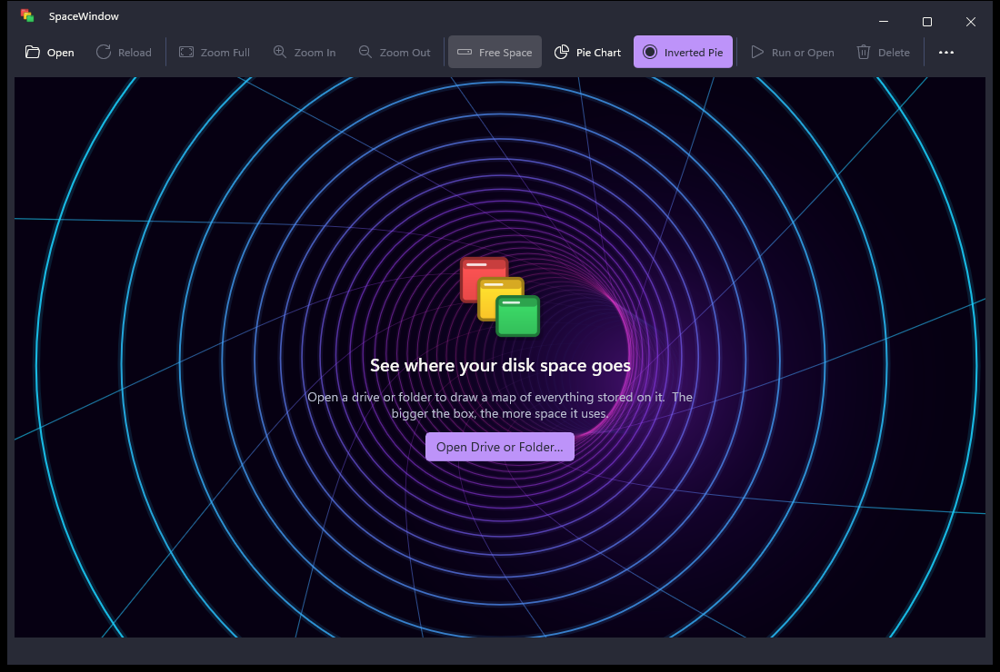

## Contents

- [Based on SpaceMonger by Sean Werkema](#based-on-spacemonger-by-sean-werkema)
- [Download](#download)
- [Using SpaceWindow](#using-spacewindow)
  - [Background animations](#background-animations)
  - [Themes](#themes)
- [What changed from SpaceMonger 1.4.0](#what-changed-from-spacemonger-140)
- [Building from source](#building-from-source)
- [Forking and contributing](#forking-and-contributing)
- [Support this project](#support-this-project)
- [License](#license)

## Based on SpaceMonger by Sean Werkema

SpaceWindow is built on **SpaceMonger 1.4.0**, the freeware disk-space
visualizer written by **Sean Werkema** ([@seanofw](https://github.com/seanofw)).
SpaceMonger showed generations of Windows users "at a glance how much space
every file and folder are using", and Sean published the source code of
version 1.4.0 under the MIT License:
**[github.com/seanofw/spacemonger1](https://github.com/seanofw/spacemonger1)**.

SpaceWindow keeps what made SpaceMonger great - its treemap layout algorithm,
colour schemes, name and info tips, and the way it behaves - and rebuilds
everything around it for today's Windows. Thank you, Sean, for the original
program and for releasing its source.

SpaceWindow is an independent project. It is not affiliated with or endorsed
by Sean Werkema; please report SpaceWindow issues here, not to him.

## Download

### Windows

From the [Releases](../../releases/latest) page, download either:

- **The installer**, `SpaceWindow-<version>-x64-setup.exe` (or
  `-arm64-setup.exe`). It installs SpaceWindow for all users, with a Start
  menu entry, and removes it again from **Settings → Apps**.
- **The portable folder**, `SpaceWindow-<version>-x64.zip` (or `-arm64.zip`).
  Unzip it anywhere and run `SpaceWindow.exe`; nothing is installed, and
  deleting the folder removes it.

Either way the Windows App SDK runtime is included and the C runtime comes
with Windows, so there is no redistributable to install. Settings are kept in
`HKEY_CURRENT_USER\Software\SpaceWindow`, and any theme files you add in
`%APPDATA%\SpaceWindow\Themes`; removing the app leaves both.

The downloads are not code-signed, so Windows SmartScreen may say *"Windows
protected your PC"*: choose **More info** and **Run anyway**. (To avoid the
prompt for every file of the portable folder, open the .zip's **Properties**
and tick **Unblock** before extracting.) You can always
[build it yourself](#building-from-source).

**Requirements:** Windows 11, x64 or ARM64. (The app declares Windows 10
version 1809 as its minimum, but only Windows 11 has been tested.)

### Linux

From the [Releases](../../releases/latest) page, download
`SpaceWindow-<version>-x86_64.AppImage` (`-aarch64` for 64-bit Arm): one
file with Qt inside, for any distribution with glibc 2.35 or later - Ubuntu
22.04, Debian 12, Fedora 36 and later - on X11 or Wayland. It is tested on
Ubuntu 22.04 and 24.04, Debian 12, Fedora 44 and Arch Linux. Make it
executable and run it; nothing is installed:

```sh
chmod +x SpaceWindow-*-x86_64.AppImage
./SpaceWindow-*-x86_64.AppImage
```

Or install a package, with a menu entry, on the system's Qt: the release's
`.deb` is for Ubuntu 24.04 and later, its `.rpm` for Fedora 44, and on Arch
Linux `makepkg -si` in `packaging/arch` builds and installs one. (For other
distributions, `cpack` makes one: see [Building on Linux](#building-on-linux).)

```sh
sudo apt install ./spacewindow_<version>_amd64.deb
sudo dnf install ./spacewindow-<version>-1.fc44.x86_64.rpm
```

Settings are kept in `~/.config/SpaceWindow`, the window's size and place in
`~/.local/state/SpaceWindow`, and theme files go in
`~/.config/SpaceWindow/Themes` (or a `Themes` folder next to the AppImage).
To scan the whole system, run it as usual: folders you cannot read are listed
as unreadable, as on Windows. To build it yourself, see
[Building on Linux](#building-on-linux).

## Using SpaceWindow

**Open a drive or folder** with **Open** (Ctrl+O), by dragging a folder or
drive onto the window, or from the command line:

```
SpaceWindow.exe "D:\Projects"
```

Scanning runs in the background and can be cancelled at once, even on a
network share that stopped answering. While folders are listed, the map builds
up behind the progress card. Run SpaceWindow as administrator to also measure
folders your account cannot read: it then lists them with the backup
privilege, as backup programs do. Folders it still could not read are counted
in the status bar; click the count for the list.

As administrator, a whole NTFS drive is also read straight from its master
file table instead of folder by folder, which is quicker. The drive itself is
only ever read.

**Reload** (F5) then takes a fraction of a second, because only what changed
is read again: on a drive read from its master file table, the files that the
drive's change journal names; anywhere else, the folders SpaceWindow saw
change since the scan. **Full Rescan** (Shift+F5) scans everything again, and
**Rescan “folder”** in the context menu scans just one folder (the one
right-clicked, or holding the file right-clicked).

A file with several names (hard links, as Windows keeps many of its own files)
is listed under each name but counted once, so that the map adds up to what
the drive holds: under the name nearest the top of the drive (so
`C:\Windows\System32` holds what it shares with `C:\Windows\WinSxS`). The
info tip of its other names says so.

### The map

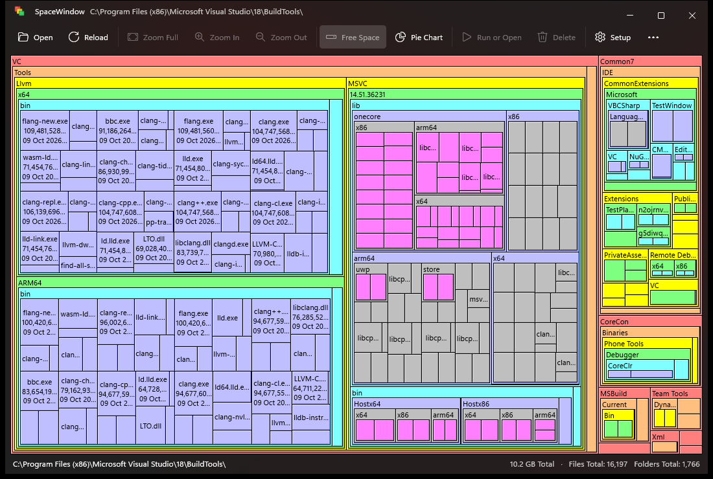

| Mouse | |
|---|---|
| Point at a box | A **name tip** shows names that don't fit their box; resting longer shows the **info tip** (size, size on disk, date, attributes, icon) |
| Click | Select (the path and size appear in the status bar) |
| Double-click | Zoom into a folder; run or open a file |
| Right-click | Context menu: zoom, run/open, delete, open, rescan (all, everything again, or one folder), free space, pie chart, properties, show in File Explorer, copy path |
| Drop a folder or drive | Scan it |

| Keyboard | |
|---|---|
| ← / ↑ / → / ↓ | Move the selection to the nearest box or slice in that direction |
| Enter | Zoom into the selected folder, or run/open the selected file |
| Alt+↑ / Backspace | Up one level (Zoom Out); the folder you came out of is selected |
| Alt+↓ | Down one level: towards the selection, or else back down the way you came up |
| Alt+← | Back to the previous view |
| Alt+→ | Forward again, to the view you went back from |
| Home | All the way out (Zoom Full) |
| Esc | Clear the selection |
| Ctrl+O | Open a drive or folder |
| F5 | Reload: read again what changed (the view stays zoomed where it was) |
| Shift+F5 | Full Rescan: scan everything again |
| Ctrl+P | Switch between the treemap and the pie chart |
| Ctrl+Shift+P | Switch between the treemap and the inverted pie chart |
| Del | Move the selection to the Recycle Bin (asks first) |
| Alt+Enter | Properties |
| Ctrl+Shift+C | Copy the selected path |
| Menu | Context menu for the selection (the Menu key) |
| F1 | About |
| Alt | Show the access keys of the toolbar and menus |

Alt+↑ and Alt+↓ retrace each other: go up a few levels, and Alt+↓ takes you
back down the same way (the next folder down is selected, so you can see where
it leads). Back and Forward remember the last 100 views, and keep working
after a reload. **Setup** lists all the shortcuts too.

A folder whose name is too long for its box shows the beginning of its name
followed by "...", as long as at least its first five letters fit; in a smaller
box the name is left out. Either way it never runs past the box, and the name
tip shows it whole.

When a whole drive is scanned, its **free space** and the space used by files
SpaceWindow could not see (**unscanned**, such as the file system's own files,
or other users' folders) appear in the map too; the **Free Space** button
hides them.

### Pie chart view

**Pie Chart** on the toolbar (or Ctrl+P, or the context menu) draws the same
map as a multi-level pie chart, and SpaceWindow remembers which view you used
last. The hub in the middle is the current folder; the ring around it is a pie
of the folder's contents, largest first, clockwise from twelve o'clock; each
ring further out shows what is inside the folders of the ring within it.
Colours mean what they mean in the treemap (the colour scheme and the nesting
depth), so each ring is one level deeper.

- Slices too thin to see are grouped into one grey slice per folder, such as
  *"944 smaller items"* (free space never is). Point at it to see what it
  holds; double-click it to zoom into that folder.
- A slice's name - and its size, when there is room - is written level in
  the middle of the slice, and only where it fits (a folder's name shortened
  with "..." as in the treemap, a file's only whole). Zoom into a folder to
  give the names inside it room; until then the name and info tips show
  them, as in the treemap.
- Selecting, zooming (double-click a folder; double-click the hub to go back
  up), the arrow keys, the context menu, delete and the rollover boxes work
  the same in all three views, and the selection is kept when you switch.

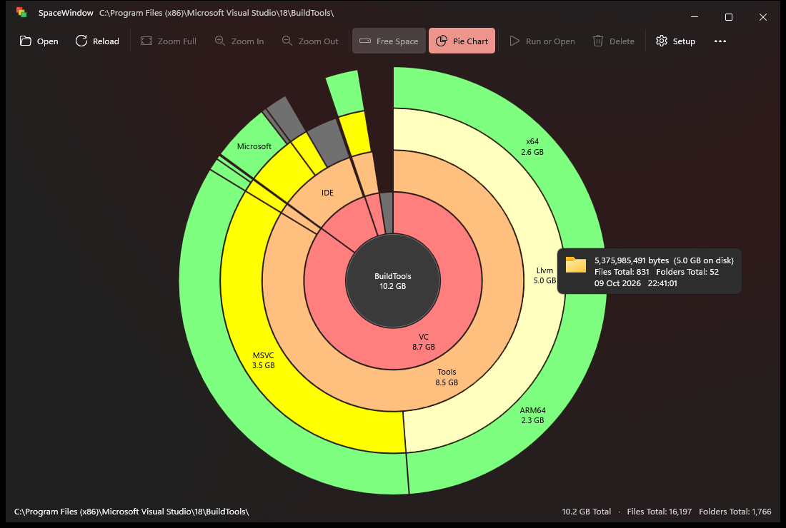

### Inverted pie chart

**Inverted Pie** on the toolbar (or Ctrl+Shift+P, or the context menu) turns
the pie chart inside out, so the rings travel inward: the current folder is
the outermost ring, left open to the background with just its name and size
at the top (double-click it to go back up); its contents are the ring inside
it, and each level deeper is one ring further in, until the slices meet in the
centre. The biggest folders get
the most room; deeper levels get less, so more of their small entries are
grouped. Everything else works as in the pie chart.

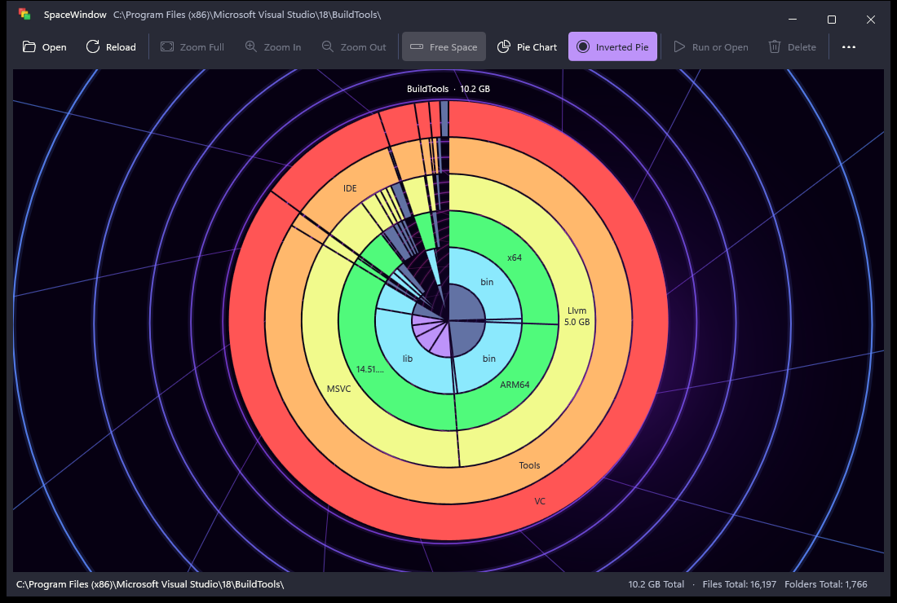

### Background animations

**Setup → Background animation** plays an animation in the space the map
leaves free: around the pie charts, through the gaps between their slices, and
behind the welcome screen (the treemap fills the whole window, so it has none).
An animation shows as soon as you pick it, and **Cancel** goes back.

| Animation | |
|---|---|
| DOOM Fire | The PSX DOOM fire, as [kiedtl/fire](https://github.com/kiedtl/fire) and the [ly](https://github.com/fairyglade/ly) display manager play it in a terminal |
| Matrix | Characters raining down the window in columns, as in CMatrix and ly |
| Colour Mix | ly's slowly swirling bands of red, blue and black |
| Game of Life | Conway's Game of Life, with new life sprinkled in now and then (as ly does) so that it never settles |
| Y2K Tunnel | An endless, curving neon tube, flown through like a year-2000 screen saver |

| | |
|---|---|
| 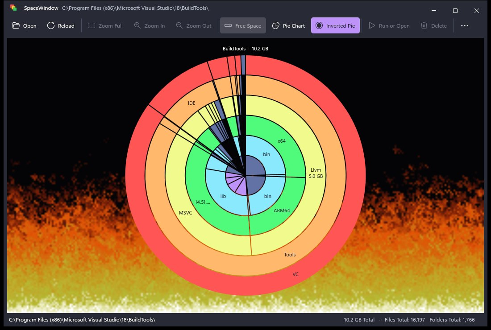 | 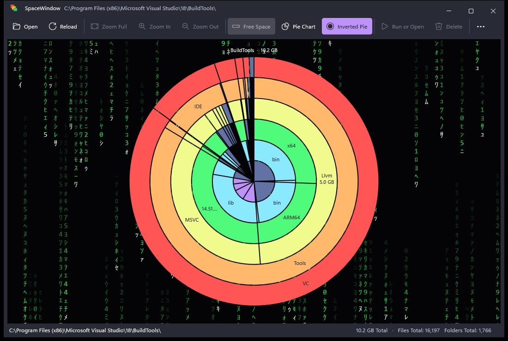 |
| 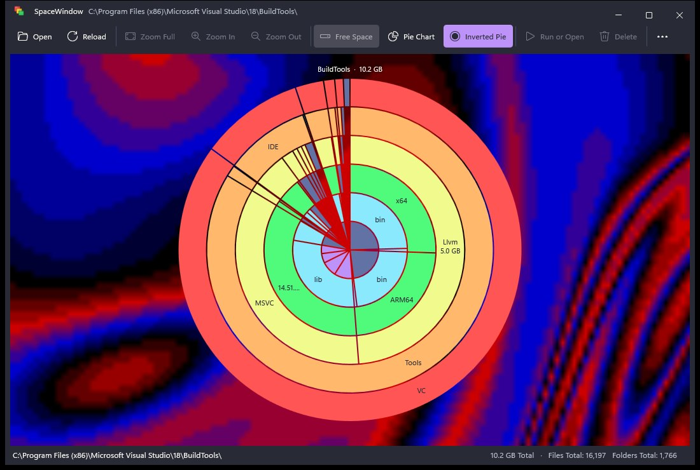 | 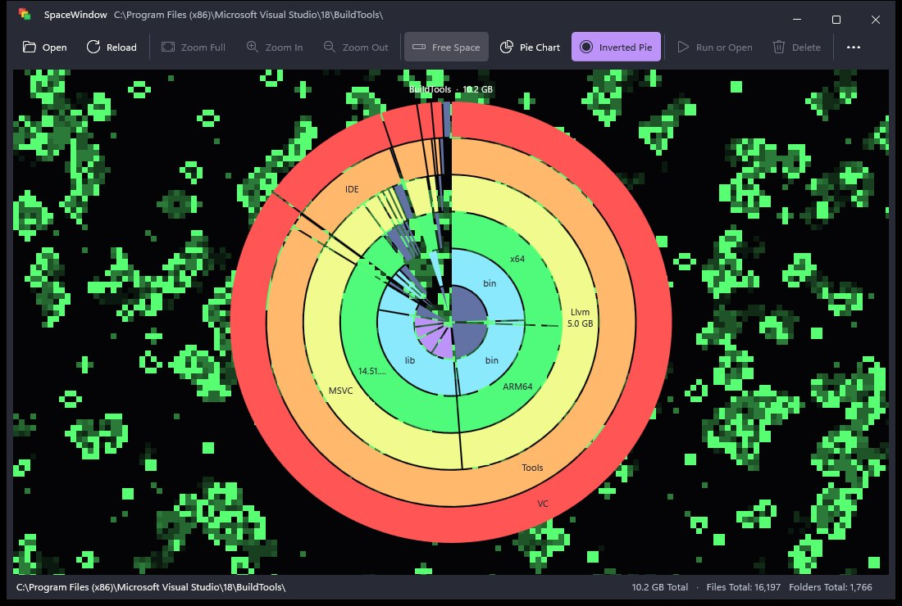 |

The animations are off until you pick one. They pause while the window is
minimized, hold still while battery saver is on and once the window has been
in the background for a minute, stay off when Windows' animation effects are
turned off, and take about 5-12% of one processor core.

### Settings

**Setup** has every option of SpaceMonger 1.4.0 - language (English US/UK,
French), label density, horizontal/vertical bias, 12 colour schemes for files
and folders, tip delays and contents, rollover boxes, animated zoom, rescan
after delete, disabling Delete, and remembering the window position - plus a
[theme](#themes), a [background animation](#background-animations) and
the list of keyboard shortcuts. The first time SpaceWindow starts, it imports
the settings of SpaceMonger 1.x if it finds them, and leaves them untouched.

| | |
|---|---|
| 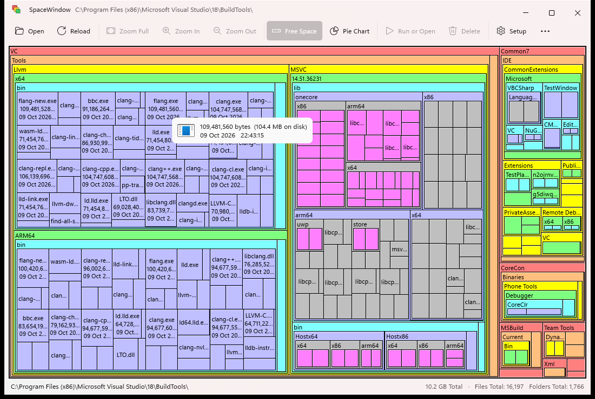 | 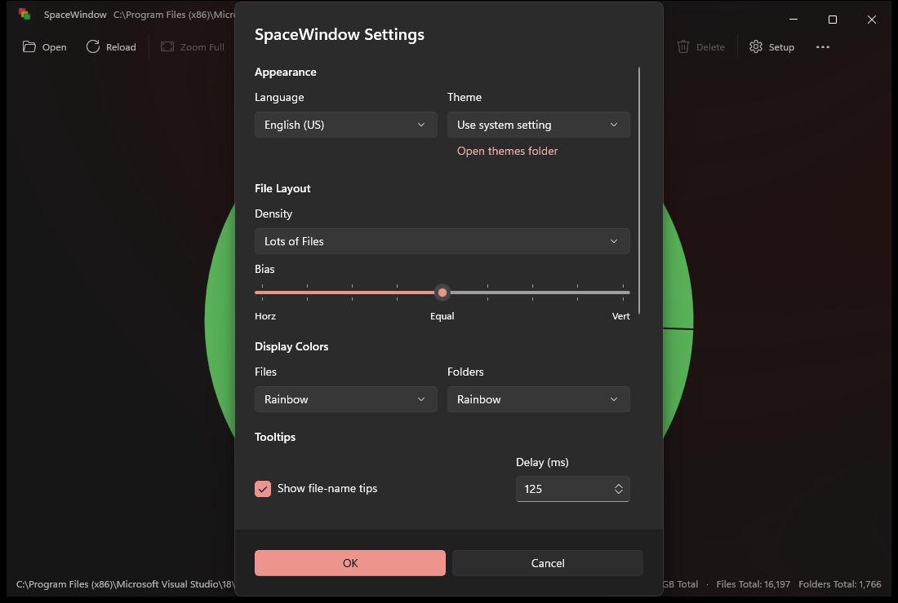 |

### Themes

**Setup → Theme** dresses the whole app in a theme: the window, the toolbar,
menus, dialogs, tips and the map. A theme shows as soon as you pick it, and
**Cancel** goes back.

| Theme | |
|---|---|
| Use system setting, Light, Dark | The Windows look: Mica, Windows' accent colour and SpaceMonger's own box colours, in Windows' light or dark mode or the one you choose |
| Dracula | The dark theme of [Dracula](https://draculatheme.com) |
| Alucard | Dracula's light theme |
| Your own | Any [theme file](#making-your-own-theme) you add |

| Dracula | Alucard |
|---|---|
| 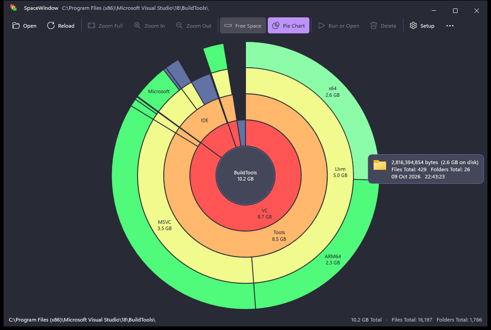 | 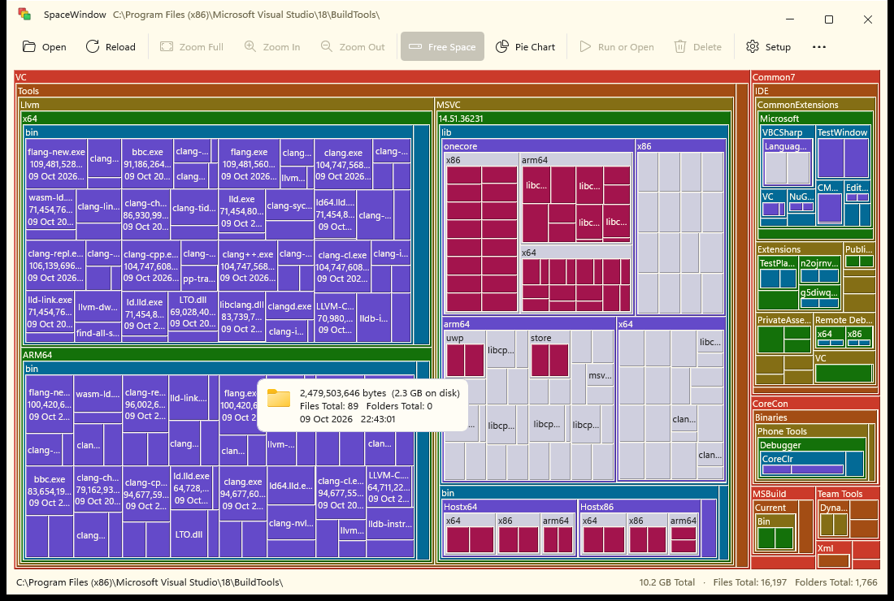 |

The Dracula and Alucard colours are the palettes of the
[Dracula Theme](https://github.com/dracula/dracula-theme) (MIT License, see
[THIRD-PARTY-NOTICES.md](THIRD-PARTY-NOTICES.md)). The colour schemes still
apply: *Rainbow* takes the theme's eight colours, *Red* its red, and so on.
Text and labels keep a readable contrast in every built-in theme, and with
Windows' high contrast turned on SpaceWindow uses Windows' colours whatever
the theme.

#### Making your own theme

A theme is a small text file called `<name>.ini`. SpaceWindow reads theme
files from `%APPDATA%\SpaceWindow\Themes` - **Open themes folder** in Setup
creates that folder and opens it - and from a `Themes` folder next to
`SpaceWindow.exe`, for a copy carried around on a USB stick. It reads them
when Setup opens, and again each time you come back to SpaceWindow while
Setup is open: edit a theme in a text editor, switch back, and see the change.
A file that cannot be used is listed in Setup with the line that is wrong.

Three colours are enough; everything else is worked out from them:

```ini
; Midnight.ini - a theme for SpaceWindow
name = Midnight          ; shown in Setup
base = dark              ; dark or light controls

[window]
background = #1B1E28
text = #E6E9F0
accent = #7AA2F7
```

All the settings:

| Setting | Colour of | If left out |
|---|---|---|
| `name` | The name shown in Setup | The file's name |
| `base` | `dark` or `light` controls | Dark if the background is darker than the text |
| **`[window]`** | | |
| `background` | The window | *Required* |
| `text` | Text | *Required* |
| `accent` | Default buttons, toggles, check boxes, links, the zoom outline | *Required* |
| `surface` | Dialogs, menus, lists and tips | A little lighter than the background |
| `secondary-text` | Captions and hints | 70% of the way from the background to the text |
| `accent-text` | Text on the accent colour | The background or the text, whichever stands out more |
| `border` | The edges of dialogs, menus and tips, and separators | 20% of the way from the background to the text |
| **`[map]`** | | |
| `rainbow` | The *Rainbow* scheme: eight colours, one per nesting level | SpaceMonger's |
| `white`, `light-gray`, `dark-gray`, `red`, `orange`, `yellow`, `green`, `aqua`, `blue`, `violet` | The single-colour schemes | SpaceMonger's |
| `windows` | The *Windows Colors* scheme | 15% of the way from the background to the text |
| `outline` | The lines between the boxes | The background |
| `selection` | The selected box or slice | The darker of the background and the text |
| `dark-text`, `light-text` | Labels on light and on dark boxes (whichever reads better) | The darker and the lighter of the background and the text |
| `free-space` | Free and unscanned space, and the pie chart's hub | The `windows` colour |
| `grouped` | The pie chart's *smaller items* slices and its outlines | 45% of the way from the background to the text |

Colours are written `#RRGGBB` or `#RGB`; `rainbow` takes eight of them,
separated by spaces or commas. Setting and section names may be in any case.
`;` starts a comment anywhere on a line, `#` at the start of one. A misspelt
setting is an error rather than ignored, so that a typo does not go unnoticed.
Files can be UTF-8 or UTF-16 text. A file named like another theme (such as
`dracula.ini`) is not used. The built-in Dracula and Alucard themes are
written in this format at the top of [src/Core/Theme.cpp](src/Core/Theme.cpp),
which makes them complete examples.

## What changed from SpaceMonger 1.4.0

### At a glance

| | SpaceMonger 1.4.0 | SpaceWindow |
|---|---|---|
| Runs on | Windows 95, 98, NT | Windows 11 (x64 and ARM64) |
| Language | C++ for Visual C++ 6, ANSI strings | C++20, Unicode throughout |
| User interface | MFC and GDI | WinUI 3 (Windows App SDK 2.5) with Mica and Fluent design |
| Drawing | 9-pixel bitmap fonts, stretched on high-DPI screens | Direct2D and DirectWrite at the screen's real resolution |
| Scanning | One thread, recursive, pumping window messages | Parallel, batched directory reads on a worker pool, with a live map; as administrator, whole NTFS drives from the master file table. Reloads read only what changed |
| Views | Treemap | Treemap, pie chart and inverted pie chart |
| Themes | Windows' colours | Light and dark, Dracula, Alucard and your own theme files |
| Paths | Up to 260 characters | Unicode, any length |
| Sizes | Up to "4096.0 Gb", from file lengths | Up to PB, real space on disk |
| Keyboard | Mouse only | Full keyboard navigation and shortcuts |
| Tests | None | 98 unit tests, 4 drive tests and a UI smoke test, AddressSanitizer, static analysis, a formatting check |

### New features

- **Pie chart view** of the same map ([details](#pie-chart-view)), and an
  [inverted one](#inverted-pie-chart) whose rings travel inward.
- **Background animations** around the pie charts: DOOM fire, Matrix rain,
  ly's colour mix, Game of Life and an endless Y2K tunnel
  ([details](#background-animations)).
- **Themes** for the whole app, map included: the Windows look, Dracula,
  Alucard, or your own theme files, previewed live ([details](#themes)).
- **Windows 11 design:** Mica backdrop, content in the title bar, a command
  bar with Fluent icons, WinUI dialogs, light and dark themes that follow
  Windows, and Windows' accent colour for the zoom animation.
- **Sharp at any scale:** per-monitor DPI awareness; outlines stay one pixel
  wide and text is crisp at every scale factor and on every monitor.
- **Smooth:** hover highlights and the zoom animation run at the display's
  refresh rate, even with tens of thousands of boxes; zooming is animated
  unless Windows' animation effects are turned off.
- **Responsive:** scanning never blocks the window, draws the map as it goes
  and can be cancelled at once - even on a network share that stopped
  answering.
- **Quick scans:** a whole 1 TB drive in 2.5 s as administrator (read straight
  from its NTFS master file table) and 4.8 s as a standard user, where
  SpaceMonger 1.4.0 takes over 30 s ([details](#performance)).
- **Instant reloads:** **Reload** reads again only what changed - the files
  the drive's change journal names, or the folders SpaceWindow saw change -
  in a fraction of a second. **Full Rescan** and **Rescan “folder”** are there
  too.
- **Hard links counted once,** so the map adds up to what the drive holds.
- **Unreadable folders listed:** the status bar counts the folders a scan
  could not read, and lists them.
- **Keyboard navigation** of the map (arrow keys, Enter, Backspace, Menu key),
  Back and Forward (Alt+← and Alt+→), up and down a level (Alt+↑ and Alt+↓),
  access keys on every command, and shortcuts that work however narrow the
  window is - all listed in Setup.
- **Folder names that fit:** a name too long for its box is shortened with
  "..." rather than cut off at the edge.
- **Shell integration:** Properties, *Show in File Explorer*, *Copy Path*,
  drag and drop, and a drive list with capacity bars.
- **Safer delete:** files go to the Recycle Bin after a confirmation (with
  *Cancel* as the default), and *Disable Delete* is honoured everywhere.
- **More accurate:** sizes are the space files really take on disk, so
  compressed, sparse and OneDrive placeholder files, and files compressed by
  Windows itself (compact.exe, CompactOS), are measured correctly, and the
  info tip shows both length and size on disk. Dates are in local time.
- **Folders of any depth** and paths longer than 260 characters.
- **Portable or installed:** a self-contained folder that runs from anywhere,
  or an installer with a Start menu entry and an uninstaller.

### Bugs fixed

SpaceMonger 1.4.0's own README listed three known problems, and all three are
fixed: junction points and mount points are no longer walked into and counted
twice, sparse (and compressed) files are measured by their real size on disk,
and hard-linked files are counted once rather than once per link (on NTFS
drives). About thirty further bugs were found and fixed along the way.

Scanning and data:
- Junctions were never detected: the probe opened folders without
  `FILE_FLAG_BACKUP_SEMANTICS`, which always fails, so linked folders were
  walked into and counted twice (or looped). Junctions, symbolic links and
  mount points are now skipped; cloud and deduplicated files are measured.
- Sizes were meant to be rounded *up* to the cluster size but were rounded
  down, so every file smaller than a cluster counted as nothing.
- The recursive scan kept a 17 KB buffer on the stack per level and
  overflowed the stack about 58 folders deep.
- The radix sort recorded each sub-folder's old position instead of its new
  one, and read an uninitialized counter.
- The scan pumped window messages from inside the recursion, so the user
  interface was re-entrant while the tree was half built.
- Window data pointers were stored with `SetWindowLong`, which truncates
  pointers on 64-bit Windows; tip timers were used uninitialized.

Display:
- 16-bit layout coordinates, and a `width × bytes` product that overflowed
  64 bits on very large drives; a percentage calculation overflowed too.
- Folders too small for their contents were laid out with negative heights.
- Empty files showed no size at all; sizes stopped at "4096.0 Gb".
- Dates were shown in UTC; file counts were printed with `%u` from 64-bit values.

Commands and settings:
- Delete copied the path into a `MAX_PATH` buffer with `strcpy` (an overflow
  on long paths), deleted without asking and ignored *Disable Delete*; the
  context menu's Delete item had its enable test inverted.
- Zoom Out and Zoom Full were greyed out whenever nothing was selected,
  rather than when there was nothing to zoom out of.
- Out-of-range registry values (density 3, colour scheme 12) indexed past
  the end of tables.
- The window position was only checked against the primary monitor.
- File icons for info tips leaked a GDI handle per hover, and `SHFILEINFO`
  was "cleared" with swapped `memset` arguments.
- `malloc`/`delete` and `new[]`/`delete` mismatches; `#define bool char`.
- French: several commands were mistranslated ("Vrombir", to roar, meant
  *Zoom In*), the licence text was in English, and two menu commands shared
  an access key.

### Performance

**Against SpaceMonger 1.4.0 itself:** both programs scanning the whole of a
1 TB system drive (NVMe; 1.94 million files and 353,000 folders) on a
16-thread PC (AMD Ryzen 9 6900HS) with a warm file-system cache; the median of
three runs after a warm-up run. SpaceMonger is timed from *OK* in its drive
dialog (or *Reload*) until the map appears, SpaceWindow from the moment it
starts (so its start-up counts against it):

| | SpaceMonger 1.4.0 | SpaceWindow | Speed-up |
|---|---:|---:|---:|
| As administrator (SpaceWindow reads the master file table) | 32.2 s | 2.5 s | **13×** |
| As a standard user (both list the folders) | 31.0 s | 4.8 s | **6.5×** |
| Peak memory use | 254–264 MB | 509–606 MB | |

SpaceMonger keeps one processor busy for the whole scan (about 32 s of
processor time). SpaceWindow spreads a standard user's scan over 12 threads
(about 46 s of processor time in 4.8 s), and leaves a quarter of the
processors free; as administrator it needs only about 2.5 s of processor
time, as reading the master file table mostly waits for the disk. It uses
about twice the memory: it is a 64-bit program, keeps more about each file
(its size on disk, and the IDs that hard links and reloads need), and draws
with WinUI and Direct3D. The two do not see quite the same files: Windows
shows SpaceMonger, a 32-bit program, `SysWOW64` in place of `System32`, and
SpaceMonger counts a hard-linked file once per name and skips paths longer
than 260 characters.

**The scanners alone** (`CoreTests.exe --bench`), on the same PC. Scanning
`C:\Windows` (162,391 files and 46,642 folders; both scanners count
exactly the same), fastest of three runs with a warm file-system cache:

| Scanner | Time | Speed-up |
|---|---:|---:|
| SpaceMonger 1.4.0 algorithm (recursive `FindFirstFile`, one thread) | 4,753 ms | 1.0× |
| SpaceWindow, one thread | 3,066 ms | 1.6× |
| SpaceWindow, 12 threads | 445 ms | **10.7×** |

The whole system drive (`CoreTests.exe --bench C:\`, run as administrator;
times vary by a few hundred milliseconds from run to run):

| | Time | Processor time | Speed-up |
|---|---:|---:|---:|
| SpaceWindow, 12 threads, listing folders | 4,173 ms | 42,734 ms | 1.0× |
| SpaceWindow, reading the master file table | 2,249 ms | 1,938 ms | 1.9× |
| ... of which the disk takes to deliver the table | 1,879 ms | | |
| **Reload** from the change journal | 116 ms | | |
| **Reload** of watched folders (the drive's top folder listed again) | 46 ms | | |

A reload from the journal reads, off the window's thread, the records of the
files the journal names and of the large ones, in case one grew while held
open (4,092 records here); putting the changes into the tree takes 1.8 ms
on the window's thread. A reload of watched folders lists them again off the
window's thread too, and puts them in place in 46 ms on it.

Where the speed comes from:

- As administrator, a whole NTFS drive is read straight from its master file
  table (MFT), the table where NTFS keeps every file's names, sizes and
  attributes: in 4 MB blocks with six reads in flight, decoded on four
  processors while the next ones arrive, without opening a single folder. The
  tree is then put together on four processors too, each folder's entries
  copied once at their final size and each hard-linked file counted once on
  the way, so the whole scan takes little longer than the disk takes to
  deliver the table: 2.8 million records of 1 KB here.
- The drive's change journal lists every file changed since a scan, so
  **Reload** reads just those files and patches the folders they are in. The
  tree keeps an index of its folders and its large files from one reload to
  the next, so a reload's work grows with what changed, not with the drive.
  When the journal cannot tell (it was reset, or has dropped what happened
  since) or too much changed, Reload scans the drive again.
- Anywhere else - a folder, a drive scanned without administrator rights, a
  network share - the scanned folder is watched from the moment its scan
  starts (`ReadDirectoryChangesW`), and **Reload** lists again only the folders
  that changed, and counts again only the hard links of the files whose names
  came or went: about 30 ms for a folder of a few hundred megabytes here.
- A file kept open and written to (a download, a virtual machine's disk) shows
  in a folder listing as it was when last closed, and the change journal names
  it only once until it is closed. So Reload also reads the largest files, and
  those seen changing, from the files themselves.
- `GetFileInformationByHandleEx(FileFullDirectoryInfo)` lists thousands of
  entries per system call and reports each file's allocation and reparse tag,
  so no file has to be opened (but those compressed by Windows itself, whose
  real size listings hide).
- A pool of worker threads shares a queue of folders: three for every four
  processors (up to 16) on SSDs - twelve list this drive as fast as sixteen,
  with less processor time and room to spare for the window - more on network
  shares to hide latency, and only two on spinning disks, where parallel reads
  would make the heads seek.
- Each folder is totalled and sorted by the thread that finishes its last
  sub-folder, so no second pass over the tree is needed; names are stored in
  one string per folder rather than one allocation per file.
- The treemap layout reuses one scratch buffer and hit-testing skips whole
  sub-trees; the map is drawn once into a GPU bitmap, and mouse-over and
  animation frames redraw only the boxes that change.
- Release builds use whole-program optimization (`/GL`, `/LTCG`), `/OPT:REF`,
  `/OPT:ICF` and `/Gw`.

### Under the hood

- **Modern C++:** C++20 with C++/WinRT and [WIL](https://github.com/microsoft/wil);
  RAII everywhere, no raw `new`/`delete`, no MFC. Warning level 4 with warnings
  as errors and SDL checks.
- **Separation:** everything that doesn't need the user interface (scanner,
  layouts, settings, text, colours) is a library with unit tests.
- **Checked:** 98 unit tests (formatting, languages, the keyboard shortcuts
  and the README's list of them, colours, themes and theme files, treemap and
  pie chart layouts (the pie inverted too), fitting names into boxes and
  slices, the background animations, Back, Forward and the way back down,
  the folder tree's totals, walks and hard links, the scanner with junctions,
  Unicode, very long paths and 150-level trees, NTFS file records, run lists
  and change journal patches (and the index they keep), reloads of watched
  folders (hard links and unreadable folders too) and rescans of one folder,
  live maps of a scan, unreadable folders, stopping a scan blocked in I/O,
  parallel loops, settings and the 1.x import) pass in Release, Debug and
  AddressSanitizer builds; MSVC code analysis and clang-tidy report no
  findings, and every source file is formatted as `.clang-format` says. Four
  drive tests (`CoreTests.exe --volume`, as administrator) read the whole
  master file table, check that a scan from it, and a reload after files and
  folders were added, moved, renamed and deleted, match the folder scanner
  file for file, and that reloads see files growing while held open. A smoke
  test of the app itself (`tests\Ui\Smoke.ps1`) starts it, scans a folder,
  draws each view, opens Setup and About and plays a background animation -
  through UI Automation and window captures, without a single key press or
  mouse click, so it can run while you use the PC.
- **Read-only:** a drive opened for reading its master file table is only
  ever read; SpaceWindow never writes to it, and never creates a change
  journal where there is none.
- **Hardened binaries:** ASLR with high-entropy addresses, DEP, Control Flow
  Guard and CET shadow stacks.

### Where the code went

| SpaceMonger 1.4.0 | SpaceWindow |
|---|---|
| `FolderTree.cpp/.h` | `src/Core/FolderTree.*`: tree model and parallel scanner |
| `FolderView.cpp/.h` (layout) | `src/Core/TreemapLayout.*`: the same algorithm, 32-bit and allocation-free |
| `FolderView.cpp/.h` (drawing), `xapp.h` | `src/App/MapRenderer.*`: Direct2D and DirectWrite |
| `FolderView.cpp` (colours, text) | `src/Core/Palette.*`, `src/Core/Format.*` |
| `TipWnd.cpp/.h` | Name and info tips in `src/App/MainWindow.xaml`, `src/App/MainWindowTips.cpp` |
| `Mainfrm.cpp/.h`, `SpaceMonger.cpp/.h`, `Freedoc.cpp`, `Freeview.cpp` | `src/App/App.xaml.*`; the window in `src/App/MainWindow.xaml.*` and, by topic, `MainWindowCommands.cpp`, `MainWindowMap.cpp`, `MainWindowScanning.cpp` |
| `DriveDialog.cpp`, `SetupDlg.cpp`, `AboutDialog.cpp` | Dialogs in `src/App/MainWindow.xaml`, `src/App/MainWindowDialogs.cpp`, `src/App/ShellOps.*` |
| `lang.h`, `lang_en.cpp`, `lang_fr.cpp` | `src/Core/Lang.*` (plus English UK) |
| `CCurrentSettings` | `src/Core/Settings.*` |
| `SpaceMonger.rc`, `res\` | `src/App/MainWindow.xaml`, `src/App/SpaceWindow.rc`, `src/App/Assets/` |
| `E.H`, `Stdafx.h` macros | The C++ standard library and WIL |
| (new) | `src/Core/PieLayout.*`, `src/App/MapRendererPie.cpp`: the pie chart view |
| (new) | `src/Core/Ntfs.*`: reading NTFS's master file table; `src/Core/ChangeJournal.*`: reloads from the change journal |
| (new) | `src/Core/FolderWatch.*`: which folders changed since a scan, for reloads; `src/Core/IoCancellation.*`: stopping a scan blocked on a network share |
| (new) | `src/Core/Theme.*`: themes and theme files; `src/App/ChromeTheme.*`: theme colours for the WinUI controls |
| (new) | `src/Core/ViewHistory.*`: Back, Forward and the way back down (Alt+arrows) |
| (new) | `src/Core/Backdrop.*`, `src/App/MapRendererBackdrop.cpp`: the background animations |
| (new) | `src/Core/Commands.*`: the commands and the keys that run them - one table for the window's shortcuts, the map's keys, the toolbar and Setup's list |
| (new) | `src/Core/LabelFit.*`: the rules for fitting names into boxes and slices (the renderer measures and draws) |
| (new) | `src/Core/Parallel.*`: decoding the master file table and building its tree on several processors |

## Building from source

### Prerequisites

- Windows 11 on x64.
- **Visual Studio 2026** with the *Desktop development with C++* and *WinUI
  application development* workloads, **or** the free **Build Tools for Visual
  Studio 2026**:

  ```powershell
  winget install --id Microsoft.VisualStudio.BuildTools --override "--passive --wait --add Microsoft.VisualStudio.Workload.VCTools --add Microsoft.VisualStudio.Component.VC.Tools.x86.x64 --add Microsoft.VisualStudio.Component.Windows11SDK.26100 --add Microsoft.VisualStudio.ComponentGroup.UWP.BuildTools --add Microsoft.VisualStudio.Component.VC.ASAN --add Microsoft.VisualStudio.Component.VC.Llvm.Clang --add Microsoft.VisualStudio.Component.VC.Tools.ARM64 --add Microsoft.VisualStudio.Component.UWP.VC.ARM64"
  ```

  `UWP.BuildTools` provides the C++ "Windows Store" application type that
  WinUI projects build on. `VC.ASAN` and `VC.Llvm.Clang` are only needed for
  the sanitizer and analysis checks, and the two ARM64 components only for
  ARM64 builds.
- The NuGet packages (Windows App SDK 2.5.1, C++/WinRT, WIL and the Windows
  SDK build tools) are restored by `build.ps1`, which downloads `nuget.exe` if
  needed and checks that it is signed by Microsoft.
- For the installer only: [Inno Setup](https://jrsoftware.org/isinfo.php) 6.7
  or later (`winget install JRSoftware.InnoSetup`). Without it, `build.ps1`
  makes everything else.

### Build

```powershell
git clone <this repository's URL>
cd SpaceWindow
.\build.ps1                    # Release x64: restore, build, unit tests, package
```

| Command | Does |
|---|---|
| `.\build.ps1` | Restore, build Release x64, run the unit tests, package (folder, .zip, installer, winget manifest) |
| `.\build.ps1 -All` | ... plus MSVC code analysis, clang-tidy, the formatting check (`.clang-format`) and the AddressSanitizer test run |
| `.\build.ps1 -Platform ARM64` | Cross-compile for Windows on Arm |
| `.\build.ps1 -Configuration Debug -NoPublish` | Debug build, no package |

`build.ps1` runs in Windows PowerShell 5.1 and PowerShell 7. If running
scripts is disabled on your machine, start it with
`powershell -ExecutionPolicy Bypass -File .\build.ps1`.

You can also open `SpaceWindow.slnx` in Visual Studio 2026 (after one
`build.ps1` run, or let Visual Studio restore the NuGet packages) and build
*Release | x64*. The *Asan* configuration builds the unit tests with
AddressSanitizer.

The app is built into `bin\<platform>\<configuration>\SpaceWindow\`, and
`build.ps1` packages it as `artifacts\SpaceWindow-<version>-<platform>\`, a
`.zip` of it and an installer, `SpaceWindow-<version>-<platform>-setup.exe`
(see [Publishing a release](#publishing-a-release)). The test program has a
few more uses (reading the master file table needs administrator rights):

| `bin\x64\Release\CoreTests\CoreTests.exe` | Does |
|---|---|
| (no arguments) | The unit tests |
| `--volume` | ... plus the drive tests, on the drive of the temporary folder |
| `--bench <folder or drive> [threads...]` | Times the scanners - the folder scanner on that many threads too - and reloads |
| `--compare <folder>` | Compares the master file table's view of a folder with the folder scanner's, file by file |

`tests\Ui\Smoke.ps1` tests the app itself, the Release x64 build by default
(`-Exe` for another): it puts its settings back when done.

Themes recolour the WinUI controls through every name the controls know their
brushes by; `src/App/ChromeThemeKeys.h` lists them, generated from the Windows
App SDK's `generic.xaml`. After updating the Windows App SDK, run
`python tools\make_theme_keys.py` to bring it up to date.

### Building on Linux

SpaceWindow also builds on Linux as a Qt 6 app, on the same scanner, layouts,
themes and settings: see [docs/linux-port.md](docs/linux-port.md) for how it
is put together and what differs from Windows.

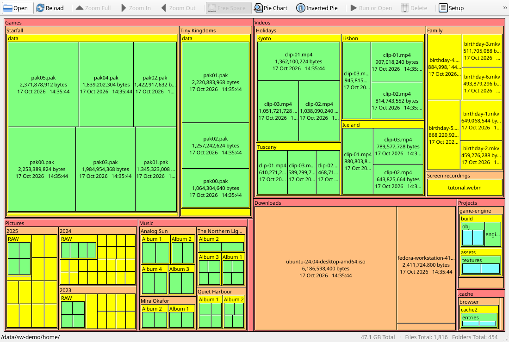

You need a C++20 compiler (tested with GCC 16 and Clang 21; CI uses Ubuntu
24.04's GCC 13 and Clang 18), CMake 3.25 or later and Qt 6.4 or later
(`qt6-base-dev`, and `qt6-qpa-plugins` for the tests; without Qt, only the
core library and its tests are built):

```sh
cmake --preset linux-release
cmake --build --preset linux-release
ctest --preset linux-release                 # unit tests, smoke tests of the window, build checks
out/build/linux-release/bin/spacewindow      # the app (add a folder to scan it at once)
cmake --install out/build/linux-release --prefix ~/.local   # with a menu entry, icons and AppStream data
```

`linux-debug`, `linux-clang` and `linux-asan` (AddressSanitizer and
UndefinedBehaviorSanitizer) are the other presets; `linux-tidy` builds with
clang-tidy, failing on any finding. `-DSPACEWINDOW_QT_BASELINE=ON` builds
the app with only what Qt 6.4 has, to try the fallbacks with a newer Qt.
`out/build/linux-release/bin/CoreTests --bench /usr` times the scanner.

Packages: `bash packaging/appimage/build-appimage.sh` builds an AppImage (it
downloads linuxdeploy, pinned and checksummed). In a build folder,
`cpack -G DEB` or `cpack -G RPM` makes a package of what `cmake --install`
installs, depending on the libraries of the system it is made on - so make
it on the distribution it is for:

```sh
cmake -S . -B out/build/package -DCMAKE_BUILD_TYPE=Release -DBUILD_TESTING=OFF
cmake --build out/build/package
cd out/build/package && cpack -G DEB         # or RPM (needs rpm-build)
```

`packaging/arch/PKGBUILD` builds the Arch Linux package from the release's
tag (`makepkg -si`), and
`packaging/flatpak/io.github.techieandroid.SpaceWindow.yml` is a Flatpak
manifest (`flatpak-builder --user --install out/flatpak <manifest>`). The
`.github/workflows` build and test both platforms; on a version tag, the
Linux one also makes a draft release with the AppImages, the `.deb` and the
`.rpm`.

On Wayland, programs cannot place their windows: SpaceWindow remembers its
size and whether it was maximized, and the desktop chooses where it opens.
To keep it in one place, use the desktop's window rules - in KDE Plasma,
right-click the title bar, *More Actions > Configure Special Window Settings*,
add *Position* and *Size*, and set them to *Remember*.

### Publishing a release

Set the version in `VERSION`, and where the Windows resources state it
(`src\App\SpaceWindow.rc`, `app.manifest`, `kVersion` in
`MainWindowShared.h`) and in the release notes of
`packaging/linux/io.github.techieandroid.SpaceWindow.metainfo.xml`:
`tools/check_versions.py` (a CTest test) checks they agree. Give that
release entry the release's date too.

Commit, and push the tag: `git tag v<version>` and
`git push origin v<version>`. The Linux workflow then builds and tests
everything once more and makes a draft release `v<version>` with the two
AppImages, the `.deb` and the `.rpm` (if a job fails, fix it and run the
workflow again: it replaces the files of its draft).

Then build both Windows platforms: `.\build.ps1` and
`.\build.ps1 -Platform ARM64`. With Inno Setup installed, `artifacts\` then
holds each platform's folder, `.zip` and installer, and the release's winget
manifest in `artifacts\winget\manifests\r\recompiler\SpaceWindow\<version>\`.
The manifest expects the installers in the GitHub release `v<version>` and
pins their SHA-256 hashes, so upload the files of that same build, unchanged.

1. Upload the two `.zip` files and the two installers to the draft release,
   write its notes, and publish it.
2. Check the manifest and try it, installing from the release (the first
   command once, as administrator):

   ```powershell
   winget settings --enable LocalManifestFiles
   winget validate --manifest artifacts\winget\manifests\r\recompiler\SpaceWindow\<version>
   winget install --manifest artifacts\winget\manifests\r\recompiler\SpaceWindow\<version>
   ```

3. Submit it to the [winget package repository](https://github.com/microsoft/winget-pkgs)
   with [WinGetCreate](https://github.com/microsoft/winget-create)
   (`winget install wingetcreate`), which signs in to GitHub and opens the
   pull request. Automated checks and a moderator review it; on a first pull
   request, a bot also asks you to sign Microsoft's contributor agreement.

   ```powershell
   wingetcreate submit artifacts\winget\manifests\r\recompiler\SpaceWindow\<version>
   ```

Once merged, `winget install recompiler.SpaceWindow` installs SpaceWindow.
Later versions can skip the manifest: after uploading their installers,
`wingetcreate update recompiler.SpaceWindow --version <version> --urls
<x64 installer URL> <arm64 installer URL> --submit` writes and submits it.

For Arch Linux, once the release is published, update the AUR package as
`packaging/arch/PKGBUILD` says at its top: set `pkgver`, run `updpkgsums`
and `makepkg --printsrcinfo > .SRCINFO`, and push both files to the AUR.

### Project layout

```
SpaceWindow.slnx                  Visual Studio solution
build.ps1                         restore, build, test, check and package
VERSION                           the version, read by build.ps1 and CMake
CMakeLists.txt, CMakePresets.json the Linux build (CMake)
src/Presenter/                    the window's logic without a toolkit (the Qt app's; WinUI's to follow)
src/AppQt/                        the Qt 6 app (Linux)
tests/AppQt/                      a smoke test of the Qt app
packaging/linux/                  the desktop entry, AppStream metainfo and icons
packaging/appimage/, flatpak/,    the AppImage build, the Flatpak manifest and the Arch Linux package
  arch/                           (the .deb and .rpm are CPack's, set up in CMakeLists.txt)
.github/workflows/                CI: both platforms built and tested; the Linux packages drafted into releases
build/SpaceWindow.Cpp.props       compiler and linker settings shared by all projects
src/Core/                         static library: scanner, layouts, settings, text, colours
src/App/                          the WinUI 3 app
tests/CoreTests/                  unit tests, drive tests, the scanner benchmark and comparison
tests/Ui/                         a smoke test of the app, without keyboard or mouse input
installer/SpaceWindow.iss         the installer (Inno Setup), built by build.ps1
tools/                            clang-tidy runner, window capture, winget manifest, icon and theme-key
                                  generators, and the checks that keep the two builds in step
.clang-format                     how the code is formatted (checked by build.ps1 -Analyze)
docs/screenshots/                 the pictures in this README
```

## Forking and contributing

SpaceWindow is free and open source under the MIT License, like SpaceMonger:
you may use it, copy it, change it, fork it, ship your own version or even
sell it, for any purpose. The only condition is to keep the copyright and
license notice ([LICENSE.txt](LICENSE.txt)) with your copies.

Bug reports, ideas and pull requests are welcome. Before sending a pull
request, please run `.\build.ps1 -All` (it builds, tests and runs the
analysis, formatting and sanitizer checks) and `tests\Ui\Smoke.ps1`, and
keep them free of warnings; on Linux, `ctest` in the `linux-release` and
`linux-asan` presets, and a `linux-tidy` build.

## Support this project

SpaceWindow is free. If it helps you find a few gigabytes, or you'd like to
support the time that went into putting it together, you can buy me a coffee
on Ko-fi:

<a href="https://ko-fi.com/recompiler"></a>

**[ko-fi.com/recompiler](https://ko-fi.com/recompiler)** - thank you!

## License

[MIT](LICENSE.txt). SpaceMonger is Copyright © 1998–2020 Sean Werkema;
SpaceWindow is Copyright © 2026 recompiler. The colours of the Dracula and
Alucard themes are from the Dracula Theme, Copyright © 2023 Dracula Theme,
also under the MIT License ([THIRD-PARTY-NOTICES.md](THIRD-PARTY-NOTICES.md)).

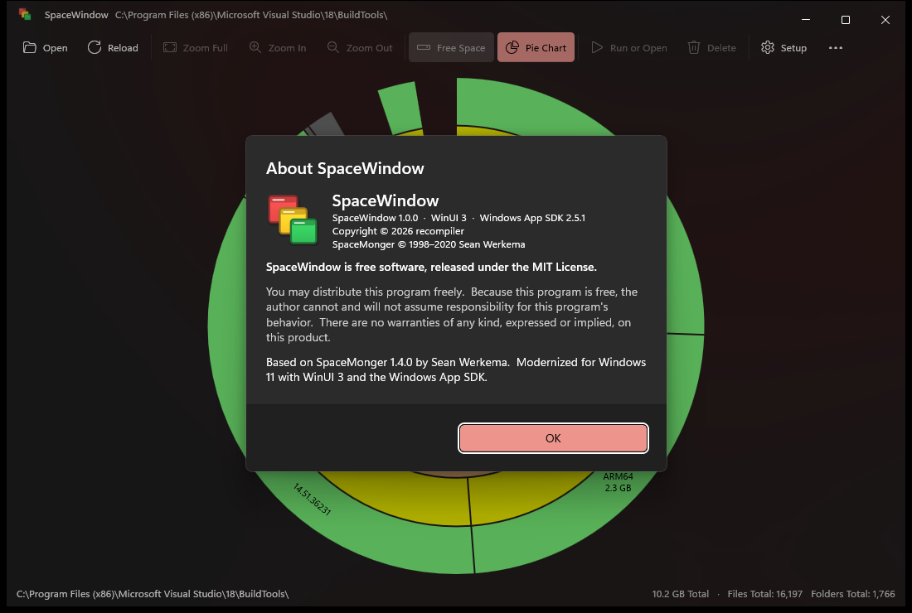
