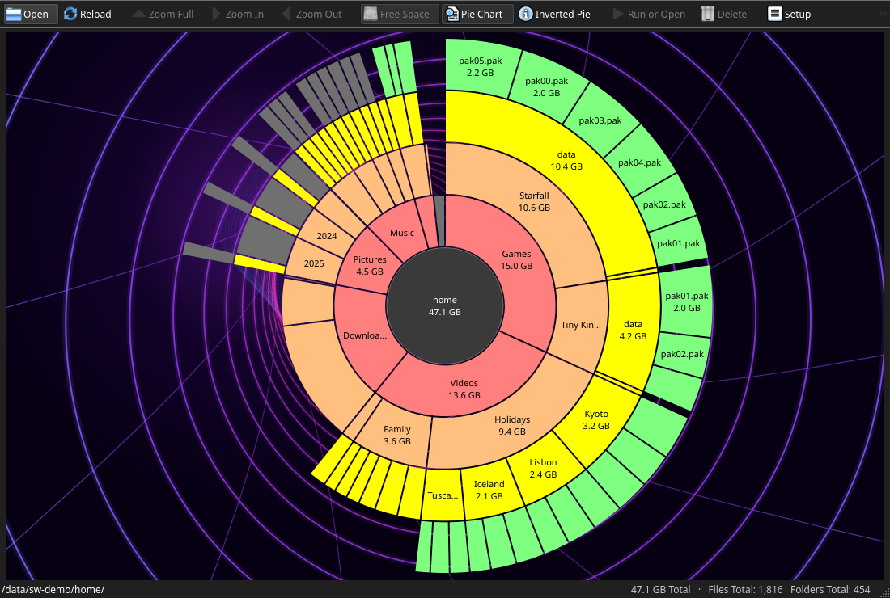

# SpaceWindow on Linux

How the Linux port is put together, the decisions it rests on, and what is
left.

## Where it stands

| Phase | | Status |
|---|---|---|
| 1 | `src/Core` and its unit tests build and pass on Linux (CMake) | **done** |
| 2 | The window's toolkit-neutral logic in a shared presenter (`src/Presenter`) | **done for the Qt app**; the WinUI app still has its own copy |
| 3 | A Qt 6 Widgets app (`src/AppQt`, the `spacewindow` program) | **done**: everything the WinUI app does, see below |
| 4 | Packaging and CI | **built and tried**: the AppImage, the Flatpak, a `.deb`, an `.rpm` and the Arch package, each installed and run; the workflows' jobs run step by step on their systems. **Not yet run on GitHub** |

Measured on Linux 7.1 (XFS and tmpfs) with GCC 16 and Clang 21, Qt 6.10:

- `ctest` runs `CoreTests` (109 tests), the window's smoke test at 100 %,
  125 % and 200 % scale (21 steps each), the benchmark on a small folder, and
  two checks that the Windows and Linux builds agree (version, source lists).
  All pass in the Release, Debug (`_GLIBCXX_ASSERTIONS`), Clang and
  AddressSanitizer + UndefinedBehaviorSanitizer builds (leak detection on).
  The build is warning-free with `-Wall -Wextra -Wpedantic -Werror`, the
  `linux-tidy` build finds nothing, and the sources are formatted as
  `.clang-format` says (checked with clang-format 19, 20 and 23).
- Built and tested from the oldest supported Qt to the newest: Ubuntu
  24.04's Qt 6.4.2 (GCC 13 and Clang 18, as CI), Qt 6.8.3 (the AppImage's,
  GCC 12), Fedora 44's Qt 6.11.2 (GCC 16), Arch Linux's Qt 6.12.0 (GCC 16,
  with makepkg's LTO and `_GLIBCXX_ASSERTIONS`), and the KDE 6.11 Flatpak
  runtime (GCC 15.2): no warnings, all tests pass.
- The Qt app also builds with only the API of Qt 6.4
  (`-DSPACEWINDOW_QT_BASELINE=ON`, all tests pass), and every Qt source
  compiles against Debian 12's Qt 6.4.2 headers.
- A scan of `/` agrees with `find` file for file: the same 634,975 files, the
  same 43,072,909,312 bytes on disk with hard links counted once, the same 69
  folders an ordinary user cannot read.
- Speed (`CoreTests --bench /usr`, warm cache, 16-thread Ryzen 9 6900HS):

  | `/usr`: 560,135 files, 48,923 folders | time | speed-up |
  |---|---:|---:|
  | `readdir` + `lstat`, one thread (what `du` does) | 1,319 ms | 1.0× |
  | scanner, one thread | 1,397–1,439 ms | 0.93× |
  | scanner, 12 threads (the default here) | 228 ms | 5.8× |
  | ... watching the tree for reloads (inotify) | 284–287 ms | 4.6× |
  | reload when nothing changed | 0.1 ms | |

## The Qt app

`spacewindow [folder]` (`--help`, `--version`), or `cmake --install` it for a
menu entry, icons in every size and the AppStream data software centres
show. It is the WinUI app's counterpart, on the same core library and the
shared presenter:

- The treemap, the pie chart and the inverted pie chart, drawn with `QPainter`
  in the screen's physical pixels (outlines one pixel wide at any scale): the
  map is drawn once per layout into an image, and the selection, the boxes
  under the mouse and the zoom animation are drawn over it on the screen, with
  no copy of the map per frame. The image covers exactly the device pixels
  Qt gives the map's widget - at 125 % or 175 % its edges fall between
  pixels, and Qt rounds each on its own - so no row is cut off or left
  stale, and the overlay lines up with it. Rollover boxes, name tips, info
  tips with the file's icon from the desktop's icon theme.
- The five background animations (DOOM fire, Matrix, colour mix, Game of
  Life, Y2K Tunnel) around the pie charts and behind the welcome screen, at
  their own pace up to 60 frames a second. They hold still on their last
  frame once the window has been in the background for a minute (counted
  from its launch if it never got the keyboard) and while
  the desktop saves energy (power-profiles-daemon's *power-saver* profile),
  and stop when the window is minimized, when the desktop's animations are
  off, and in high contrast - the rules of the WinUI app, now in the
  presenter (`BackdropClock`) where both can share them.
- Scanning in the background with a progress card, a live map of the scan and
  Cancel; Reload of only the folders inotify saw change; Full Rescan; Rescan
  of one folder. Closing the window stops the work and waits at most two
  seconds for it: a scan stuck on a network drive that stopped answering no
  longer holds the program open.
- Every command of the toolbar and the context menu, the keyboard shortcuts of
  the shared command table (the same keys as on Windows), Back and Forward,
  drag and drop of folders and files, and the folder given on the command line.
- The drive dialog (mounted disks and network shares, with capacity bars), all
  of Settings (with the list of shortcuts), About, the unreadable folders. A
  theme, a language or an animation picked in Settings shows at once, in the
  window and in Settings itself; Cancel puts back what was there. Theme files
  edited while Settings is open are read again when SpaceWindow comes back to
  the front.
- Themes. The three classic ones are the desktop's own look - its style
  (Breeze on KDE) and its palette - in the light or dark the theme asks for
  where the desktop offers it (on Qt 6.8 and later SpaceWindow asks; KDE
  keeps its own), and Fusion in Windows 11's light or dark colours where it
  does not. The colour themes (Dracula, Alucard, theme files) use Fusion, which
  takes their palette whole. "Use system setting" follows the desktop when it
  switches between light and dark.
- High contrast (the Settings portal's `contrast`, or Qt 6.10's own reading)
  puts the desktop's look over any theme and stops the animations, as on
  Windows. GNOME publishes it; KDE Plasma's own portal (6.7) does not, but
  Plasma's portal set-up (`Settings=kde;gtk`) publishes GNOME's
  `high-contrast` setting through xdg-desktop-portal-gtk where it is
  installed.
- "Use system setting" follows the light or dark the desktop says it is
  (`QStyleHints::colorScheme`, Qt 6.5 and later) even where the desktop's
  palette does not: the AppImage on GNOME has the portal's platform theme,
  which hears the switch but keeps Fusion's light palette, so SpaceWindow
  then takes Windows 11's light or dark colours, as for an explicit Light
  or Dark.
- Open with the desktop's application, Show in File Manager and Properties
  (asked of the file manager through `org.freedesktop.FileManager1`, without
  waiting for it), Move to Trash (asking first), Copy Path. File names that
  are not UTF-8 go to all of them as their bytes: the file manager gets a
  `file:` URI of the bytes, Open runs `xdg-open` with them, and the trash is
  SpaceWindow's own implementation of the freedesktop.org Trash specification
  (`posix::MoveToTrash`). In a Flatpak the trash goes through the desktop's
  Trash portal.
- The window's size and place are saved with Qt's `saveGeometry` in
  `$XDG_STATE_HOME/SpaceWindow/state.ini`, and restored when Settings asks for
  it ("Remember window position"); a window that would be off every screen
  comes back on one. On Wayland, where programs cannot place their windows,
  the size and the maximized state come back and the desktop picks the place
  (KDE's window rules can remember it: see the README).

`tests/AppQt/SmokeTest.cpp` drives the real window with simulated mouse and
keys on Qt's offscreen platform: scan; the window, drawn whole at several
sizes, shows the map pixel for pixel, and the selection only inside its box;
select, zoom in and out, Back,
the arrow keys, the pie charts, the info tip, the context menu; Reload after
files came and went; Rescan of one folder and Full Rescan; drag and drop;
Settings; switching between classic and colour themes (style and palette);
the live preview of a theme and a language, and Cancel; the background
animation, and holding it still for power saving and high contrast; Move to
Trash, also of a file whose name is not UTF-8; the window's size and place
over a restart; and closing while a scan of `/usr` runs. Dialogs and menus
are waited for, not timed. It runs with its own settings, state, trash and
no D-Bus, so the user's are never touched. (Its own home folder, too: Qt
6.4's trash takes the home trash only for files on the home's file system.)

Checked by hand with the AppImage, at 125 %: on KDE Plasma 6.7 (X11, and
Wayland in a nested KWin), and on GNOME 46 (Wayland in a nested GNOME Shell
with fractional scaling, and X11 at 120 dpi):

- the window follows the desktop's switch between light and dark;
- drag and drop from Dolphin and Nautilus (a folder is scanned; a file scans
  the folder it is in);
- Show in File Manager selects the file in Dolphin and Nautilus, also one
  whose name is not UTF-8; Properties opens the file manager's dialog;
- Move to Trash puts the file in the user's trash, with a name that is not
  UTF-8 too: GIO (Nautilus) lists it there with its original path; KDE's
  KIO cannot handle such names, so Dolphin's trash view leaves it out;
- high contrast puts the desktop's look over the Dracula theme and stops the
  animation, and turning it off brings both back; in power-profiles-daemon's
  power-saver profile the animation holds still (tried on KDE: the nested
  GNOME sessions had no system bus);
- one press of the Menu key opens the context menu once, on X11 and Wayland.
  (The X11 and Wayland plugins turn the key into a context-menu event first;
  the key press then goes to the open menu, not the map. The map's own
  handling of the key covers platforms that do not, such as the offscreen
  one.)

What is not there:

- Folders whose names are not UTF-8 cannot be picked from Qt's own folder
  dialog (the desktop's portal dialog hands them over whole, and the drive
  list, the command line and drag and drop take them too). Info tips give
  such files the icon of their type, by the name's extension.
- The workflows have not run on GitHub, and the arm64 AppImage has not been
  built (no Arm machine here): see Packaging and CI.

The Windows build is unchanged in behaviour: every Windows code path is kept
as it was, inside `#ifdef _WIN32`, and the Linux implementations sit beside it
or in files only the CMake build compiles (`tools/check_sources.py` lists
them). It could not be compiled on Windows while the port was made: run
`build.ps1 -All` before merging.

## How the core library is split

| | Windows (MSBuild) | Linux (CMake) |
|---|---|---|
| Listing folders | `GetFileInformationByHandleEx` (`FolderTree.cpp`) | `getdents64` + `statx`, from each folder's descriptor (`FolderTreePosix.cpp`) |
| Volume, free space, kind of disk | `GetVolumePathName`, `IOCTL_STORAGE_QUERY_PROPERTY` | `/proc/self/mountinfo`, `statvfs`, `/sys/dev/block/*/queue/rotational` (`Posix.cpp`) |
| Hard links | NTFS record numbers | each tree numbers its inodes itself (`InodeTable`, `Posix.h`) |
| Reloads | `ReadDirectoryChangesW` (`FolderWatch.cpp`); the NTFS change journal | inotify (`FolderWatchPosix.cpp`) |
| Whole NTFS drives | the master file table (`Ntfs.cpp`) | not read (the record parser builds and is tested) |
| Stopping blocked I/O | `CancelSynchronousIo` (`IoCancellation.cpp`) | a signal that interrupts system calls (`IoCancellationPosix.cpp`) |
| The trash | the shell (`src/App/ShellOps.cpp`) | the freedesktop.org Trash specification (`TrashPosix.cpp`) |
| Settings | `HKCU\Software\SpaceWindow` | `$XDG_CONFIG_HOME/SpaceWindow/settings.ini`, the same value names |
| Theme folders, text, dates, language | Win32 | `std::filesystem`, a UTF-8 decoder, `localtime_r`, `$LANGUAGE`/`$LANG` |

`Compat.h` gives Linux the Windows constants the library speaks
(`FILE_ATTRIBUTE_*`, reparse tags, virtual-key codes): the tree keeps
Windows' attributes and FILETIME dates on every system.

## Decisions

- **Strings stay `std::wstring`.** On Linux `wchar_t` holds a whole code point
  (UTF-32), so names take more memory than on Windows (about 2 bytes more per
  letter). File names are bytes, usually UTF-8; bytes that are not UTF-8
  become U+DC80..U+DCFF and go back to the same bytes, so every name
  round-trips (`posix::FromNative`/`ToNative`; tested). Qt's strings are
  UTF-16 and cannot hold such names: wherever a name leaves for the desktop,
  it goes as bytes.
- **Paths use `sm::kPathSeparator`** (`'/'` on Linux) and are compared byte for
  byte (`kCaseInsensitivePaths`). There is one form of path, of any length:
  folders are opened one level at a time when a path is longer than
  `PATH_MAX` (tested with a path of over 4,200 bytes).
- **Record numbers.** The tree's hard-link logic wants dense 32-bit record
  numbers, as NTFS has; Linux inode numbers are 64-bit and sparse (XFS's run
  into the billions). Every file and folder a scan meets gets the next number
  from the tree's `InodeTable` (16 to 40 bytes a file), renumbered in inode
  order after the scan so that trees come out the same whatever the number of
  threads. Rescans of part of the tree reuse the table; the files they meet
  are numbered as they come, so where two names of a file are equally near
  the root, the folders' own inodes decide which counts it - as a fresh scan
  would (tested).
- **Why every file, not only those with several links.** Numbering only
  folders and files with `st_nlink > 1` would make the table a few megabytes
  instead of tens, but reloads would then miss hard links made later:
  inotify tells a folder nothing when a file in it gains or loses a link
  elsewhere (checked: no `IN_ATTRIB` reaches the folder's watch).
- **What is skipped.** Symbolic links, and file systems mounted inside the
  scanned folder (`STATX_ATTR_MOUNT_ROOT`): a scan of `/` leaves out `/proc`,
  `/sys`, `/dev` and other drives, as a Windows scan skips mount points. A
  btrfs subvolume is not a mount and is scanned.
- **Sizes** are blocks allocated (`st_blocks`), as `du` counts them; files with
  holes are marked sparse. Reflinked copies (btrfs, XFS) share blocks that
  `stat` cannot see, and count once per copy, as they do for `du`. On network
  file systems `statx` asks the server (`AT_STATX_SYNC_AS_STAT`), not what
  the client last heard; local ones are not made to flush anything.
- **Unreadable folders.** A folder that cannot be opened, and one that lists
  its names but cannot be searched (`r--`: nothing can be asked about what is
  in it), count as unreadable, rather than empty (tested).
- **Free space** counts the blocks reserved for the superuser, so that they do
  not show as unscanned.
- **inotify** watches one folder at a time: the scanner hands it each folder
  before listing it, and the watch adds folders made or moved in later. Past
  half of `fs.inotify.max_user_watches` (or 200,000 folders) it gives up, and
  says that it ran out of watches: that tree is then scanned again without
  trying to watch it all once more (tested). Network shares are not watched
  (inotify does not hear of other machines' changes).
- **Stopping** a scan sends its threads a real-time signal installed without
  `SA_RESTART`: reads from FUSE file systems, pipes and `intr` NFS mounts end
  at once. A disk that does not answer still holds its thread; the window
  waits two seconds for its threads, then leaves the stuck ones behind (with
  the tree they read) and the program ends without running destructors under
  them.
- **The trash** follows the specification on the file's bytes: the user's
  trash for files on its file system, `$top/.Trash/$uid` (where the
  administrator made one) or `$top/.Trash-$uid` for other file systems, the
  information file made first (`O_EXCL`) to hold the name, `Path=` escaped as
  the specification says, namesakes kept as `name.2`, `name.3`, ...; nothing is
  ever copied from one file system to another. Qt's own trash is used for
  names that are UTF-8.
- **No administrator mode.** The superuser reads every folder anyway; an
  ordinary user's scan counts the folders it cannot read, as on Windows.
- **Qt 6.4 and later.** What later versions added is used where they have it
  (`QtCompat.h`): the colour scheme request (6.8), the palette's accent (6.6),
  the event for a changed screen scale (6.6; before it, the map notices in its
  next paint), the contrast preference (6.10).
- **The version** lives in `VERSION`, read by CMake and `build.ps1`; the files
  that must state it themselves (the Windows resources and manifest, the WinUI
  About text, the AppStream release) are checked against it by
  `tools/check_versions.py`.

## Packaging and CI

- `packaging/linux`: the desktop entry, the AppStream metainfo and the icon in
  nine sizes, named `io.github.techieandroid.SpaceWindow` (the desktop file
  name the app announces, so Wayland compositors and docks match its window).
  The metainfo's screenshots point at `docs/screenshots/linux-*.png` on the
  `main` branch, which they reach once merged.
- `packaging/appimage/build-appimage.sh`: builds and installs into an AppDir,
  then `linuxdeploy` with its Qt plugin (pinned releases, SHA-256 checked)
  bundles Qt, the X11 and Wayland platform plugins and Wayland's shell
  integrations, and the portal platform theme, into
  `SpaceWindow-<version>-<arch>.AppImage`. Not the GTK theme, which would
  bundle GTK. The plugin's start-up hook asks for the `gtk2` theme on GNOME
  and Xfce, which the AppImage does not have: inside an AppImage the app asks
  for the portal theme instead (`main.cpp`), which hears the desktop's light,
  dark and contrast wherever there is a portal. Built on Ubuntu 22.04, it
  needs glibc 2.35 and GCC 12's libstdc++; run on Ubuntu 22.04 and 24.04,
  Debian 12, Fedora 44 and Arch Linux.
- `.deb` and `.rpm`: CPack (`CMakeLists.txt`). Their dependencies are the
  library packages of the system that makes them (dpkg-shlibdeps, rpm's own),
  plus Qt's platform plugins, which no library links to (`qt6-qpa-plugins`;
  Wayland's are recommended). The RPM leaves the folders other packages own
  (`filesystem`, `hicolor-icon-theme`) to them: dnf refuses one that claims
  them too. Made on Ubuntu 24.04 and Fedora 44 (`1.fc44`), they are for those
  and later: Debian names its Qt packages differently (no `t64`), so Debian
  users take the AppImage or `cpack` their own.
- `packaging/arch/PKGBUILD`: builds the release tag's source with makepkg's
  flags, runs the tests and installs the licences; namcap finds nothing. For
  the AUR, its checksum is set once the tag exists (`updpkgsums`).
- `packaging/flatpak/io.github.techieandroid.SpaceWindow.yml`: the KDE 6.11
  runtime, `--filesystem=host`. Inside the sandbox `/` is the runtime's (the
  system's `/usr` is under `/run/host`) and the drive list is the sandbox's
  mounts: the Flatpak is for the user's files and drives, the AppImage or a
  distribution package for the whole system. It builds as `RelWithDebInfo`
  without `-Werror`: GCC 15.2 warns, wrongly, of an uninitialized
  `shared_ptr` at `-O3 -g`, and a newer SDK's compiler should not fail
  Flathub's build. For Flathub, flatpak-builder-lint asks for exceptions for
  `--filesystem=host` and `host-os:ro` (to be justified in the submission: a
  disk usage analyzer reads every drive), and the metainfo's screenshots
  must be reachable (once merged).
- `.github/workflows/linux.yml`: GCC, Clang and sanitizer builds and tests on
  Ubuntu 24.04 (Qt 6.4.2: the oldest supported Qt, for real), formatting,
  clang-tidy, the desktop entry and metainfo, the two builds' checks; the
  AppImages on Ubuntu 22.04 (x86_64, and aarch64 on GitHub's Arm runners);
  the `.deb` on Ubuntu 24.04 and the `.rpm` in a Fedora 44 container, each
  installed and run. On a `v*` tag, one last job makes the draft release of
  them all, once every other job has passed (run again, it replaces the
  files of its draft). `.github/workflows/windows.yml`: `build.ps1 -All`
  after installing the Build Tools as the README does.
- Tried here, without GitHub: every Linux job's steps, as written, in fresh
  root file systems of their systems (Ubuntu 24.04, Ubuntu 22.04 with
  aqtinstall's Qt as install-qt-action sets it up, Fedora 44), and the
  release step against a stand-in `gh`; actionlint (with shellcheck) finds
  nothing in either workflow.

## Tests left out on Linux

The four drive tests (`VolumeTests.cpp`), the NTFS benchmark and the MFT
comparison read NTFS volumes, and these tests are about Windows alone:
compact.exe compression, 8.3 short names, `\\?\` paths, and the numeric theme
of SpaceWindow 1.0's registry settings. Linux has tests of its own instead:
sparse files, names that are not UTF-8 (scanned, and trashed), path
normalization with symbolic links, folders that list but cannot be searched,
watches that run out, hard links tie-broken by inode.

## Next

1. The WinUI app on the shared presenter (`src/Presenter`): `MapView`, and the
   animation clock and theme choice of `Presentation`, so that the two front
   ends cannot drift apart. `sm::Sector` and `sm::RectF` then replace
   `sm::ui`'s copies. It needs a Windows machine to build and test.
2. Run the workflows on GitHub (the first tag), build the Windows side
   (`build.ps1 -All`), submit the Flatpak to Flathub and the PKGBUILD to the
   AUR, and try the arm64 AppImage on an Arm machine.
